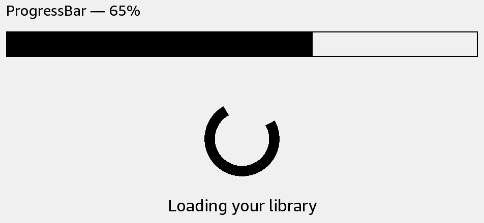

# ActivityIndicator

Show that work is in progress when you do not have a completion percentage.



## Usage

Save this example as `apps/Reader/App.js` in the [starter app](../first-app.md).

```jsx
import React from 'react';
import {ActivityIndicator, View} from 'react-kindle';

export default function App() {
  return (
    <View style={{padding: 24}}>
      <ActivityIndicator label="Loading books" />
    </View>
  );
}
```

## Props

| Prop | Type / default | Description |
|---|---|---|
| animating | boolean = true | False removes the indicator. |
| size | positive number = 116 | Width and height. |
| label | string | Text below the spinner. |
| smooth | boolean = false | Native smooth animation mode. |
| frameInterval | positive number = 250 | Milliseconds between frames; smooth mode has a 450 ms minimum. |
| style | View style | Outer layout. |

Unmounting stops the native animation. The screenshot shows one frame.
