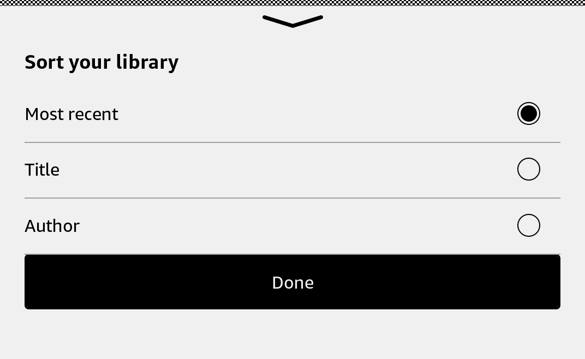

# BottomSheet

Show a short task or set of options in a native modal window at the bottom of the screen.



## Usage

Save this example as `apps/Reader/App.js` in the [starter app](../first-app.md).

```jsx
import React, {useState} from 'react';
import {BottomSheet, Button, RadioGroup, View} from 'react-kindle';

export default function App() {
  const [visible, setVisible] = useState(false);
  const [sort, setSort] = useState('recent');

  return (
    <View style={{flex: 1, padding: 24}}>
      <Button onPress={() => setVisible(true)}>Sort books</Button>
      <BottomSheet visible={visible} title="Sort books" height={360}
        onDismiss={() => setVisible(false)}>
        <RadioGroup value={sort} onValueChange={setSort} options={[
          {value: 'recent', label: 'Recent'}, {value: 'title', label: 'Title'},
        ]} />
        <Button onPress={() => setVisible(false)}>Done</Button>
      </BottomSheet>
    </View>
  );
}
```

## Props

| Prop | Type / default | Description |
|---|---|---|
| visible | boolean | Whether the sheet is open. |
| title | string | Optional heading. |
| height | number = 360 | Sheet height in layout units. |
| children | React nodes | Sheet content. |
| onDismiss | () => void | Called on downward handle gesture or native dismissal. |

The sheet spans the screen width. Update `visible` in `onDismiss` to close it.
