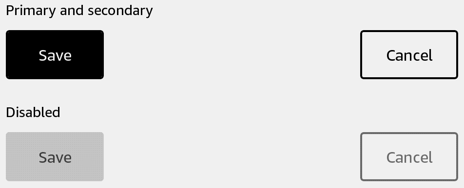

# Button

Run an action when pressed. Use a primary button for the main action and a secondary button for alternatives.



## Usage

Save this example as `apps/Reader/App.js` in the [starter app](../first-app.md).

```jsx
import React, {useState} from 'react';
import {Button, Text, View} from 'react-kindle';

export default function App() {
  const [saved, setSaved] = useState(false);

  return (
    <View style={{padding: 24}}>
      <Text>{saved ? 'Saved' : 'Ready to save'}</Text>
      <Button onPress={() => setSaved(true)}>Save</Button>
      <Button variant="secondary" onPress={() => setSaved(false)}>Reset</Button>
      <Button disabled>Unavailable</Button>
    </View>
  );
}
```

## Props

| Prop | Type / default | Description |
|---|---|---|
| children | string | Button label. |
| variant | primary (default) / secondary | Visual emphasis. |
| disabled | boolean = false | Ignores presses and uses disabled colors. |
| onPress | function | Runs on click. |
| onPressIn / onPressOut | function | Press and release callbacks. |
| onLongPress | function | A handled long press suppresses the next click. |
| feedback | invert (default) / none | Press feedback. |
| style | View style | Placement and margins. |

The component sets its own colors, border, padding, and label styling. Its base height is 56 and minimum width is 112. Height and label size follow the font scale.
