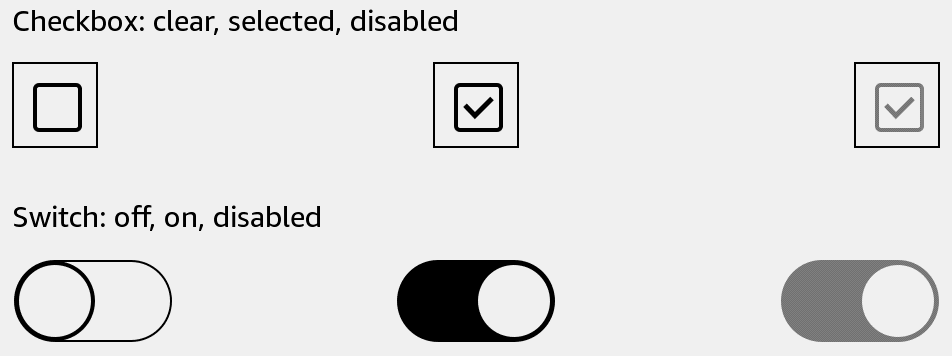

# Checkbox

Select an independent option.



## Usage

Save this example as `apps/Reader/App.js` in the [starter app](../first-app.md).

```jsx
import React, {useState} from 'react';
import {Checkbox, Text, View} from 'react-kindle';

export default function App() {
  const [enabled, setEnabled] = useState(false);

  return (
    <View style={{padding: 24, flexDirection: 'row', alignItems: 'center'}}>
      <Checkbox value={enabled} onValueChange={setEnabled}
        accessibilityLabel="Include archived books"
        style={{width: 44, height: 44, marginRight: 16}} />
      <Text>Include archived books</Text>
    </View>
  );
}
```

## Props

| Prop | Type / default | Description |
|---|---|---|
| value | boolean = false | Current selection. |
| onValueChange | (value: boolean) => void | Update your state with the new selection. |
| disabled | boolean = false | Prevents changes. |
| style | View style | Set width and height. |
| accessibilityLabel | string | Spoken label. |

The screenshot includes both checkbox and switch states. Supply a visible text label separately. Set `disabled` to show an unavailable option.
