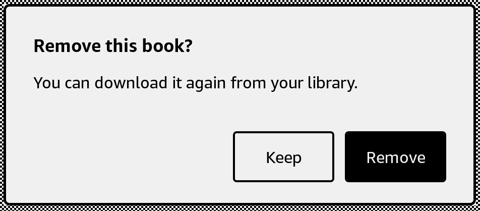

# Dialog

Ask for confirmation or show a message in a native dialog window.



## Usage

Save this example as `apps/Reader/App.js` in the [starter app](../first-app.md).

```jsx
import React, {useState} from 'react';
import {Button, Dialog, Text, View} from 'react-kindle';

export default function App() {
  const [visible, setVisible] = useState(false);
  const [removed, setRemoved] = useState(false);

  return (
    <View style={{flex: 1, padding: 24}}>
      <Button onPress={() => setVisible(true)}>Remove book</Button>
      <Text>{removed ? 'Book removed from this list' : 'Book in list'}</Text>
      <Dialog visible={visible} title="Remove book?" confirmLabel="Remove" cancelLabel="Keep"
        onConfirm={() => {setRemoved(true); setVisible(false);}}
        onCancel={() => setVisible(false)} onDismiss={() => setVisible(false)}>
        Remove this book from your reading list?
      </Dialog>
    </View>
  );
}
```

## Props

| Prop | Type / default | Description |
|---|---|---|
| visible | boolean | Whether the dialog is open. |
| title | string | Dialog heading. |
| children | string or React nodes | Message or custom content. |
| confirmLabel / cancelLabel | string = OK / Cancel | Button labels; empty cancelLabel hides that button. |
| onConfirm / onCancel | () => void | Button callbacks; close the dialog in your handler. |
| onDismiss | () => void | Native dismissal callback; defaults to onCancel. |
| style | View style | Native window layout. |

For an information dialog, set `cancelLabel=""` and close it in `onConfirm` and `onDismiss`.
