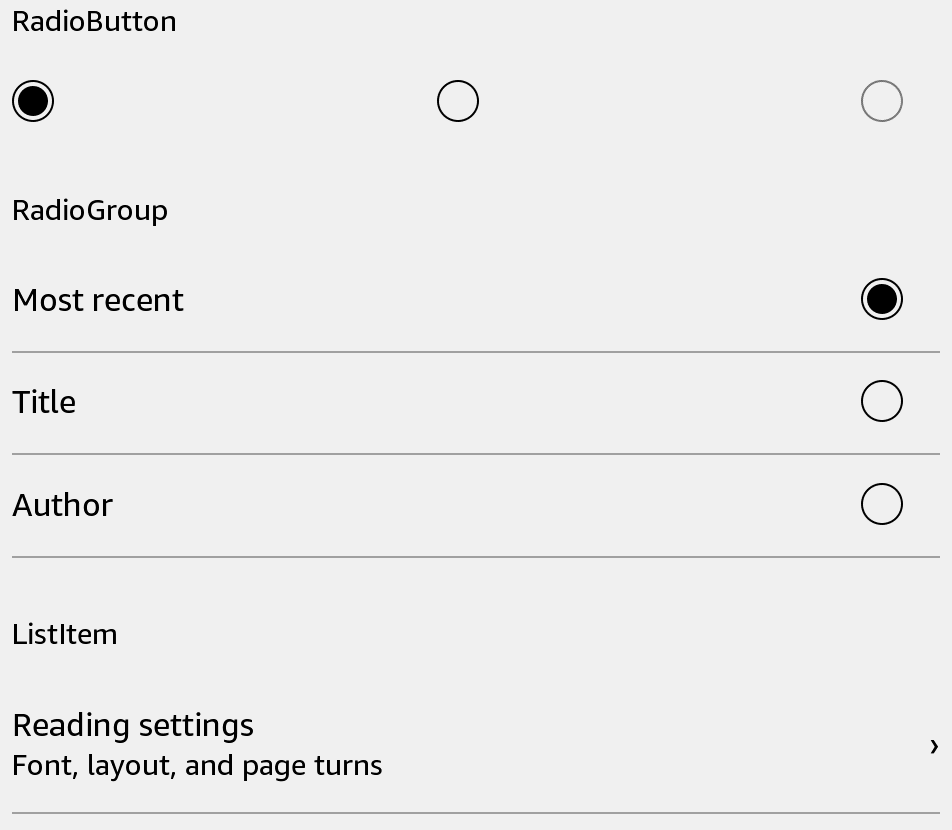

# ListItem

Show a selectable row with a title, optional subtitle, and trailing content.



## Usage

Save this example as `apps/Reader/App.js` in the [starter app](../first-app.md).

```jsx
import React, {useState} from 'react';
import {ListItem, Text, View} from 'react-kindle';

export default function App() {
  const [opened, setOpened] = useState(false);

  return (
    <View style={{padding: 24}}>
      <ListItem title="Reading" subtitle="12 books" trailing={<Text>Open</Text>}
        onPress={() => setOpened(true)} />
      <Text>{opened ? 'Collection selected' : 'Choose a collection'}</Text>
    </View>
  );
}
```

## Props

| Prop | Type / default | Description |
|---|---|---|
| title / subtitle | string | Main label and supporting text. |
| icon | Image source | Optional leading image. |
| trailing | React node | Content at the end of the row. |
| onPress | () => void | Selection callback. |
| bold | boolean = false | Bold title. |
| disabled | boolean = false | Prevents presses. |
| separator | boolean = true | Show a divider below the row. |
| style | View style | Layout overrides; minimum height is 56 scaled units. |
