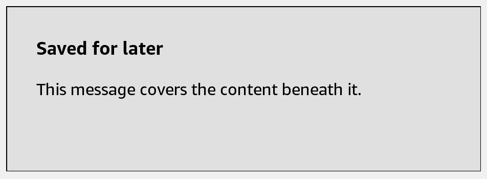

# Overlay

Cover the parent layout with custom content. Overlay stays inside the existing window.



## Usage

Save this example as `apps/Reader/App.js` in the [starter app](../first-app.md).

```jsx
import React, {useState} from 'react';
import {Button, Overlay, Text, View} from 'react-kindle';

export default function App() {
  const [visible, setVisible] = useState(false);

  return (
    <View style={{flex: 1, padding: 24}}>
      <Button onPress={() => setVisible(true)}>Show message</Button>
      <Overlay visible={visible} style={{backgroundColor: '#FFFFFF', padding: 32}}>
        <Text variant="title">Saved</Text>
        <Text>Your reading list is up to date.</Text>
        <Button onPress={() => setVisible(false)}>Close</Button>
      </Overlay>
    </View>
  );
}
```

## Props

| Prop | Type / default | Description |
|---|---|---|
| visible | boolean = true | Whether the overlay is mounted. |
| children | React nodes | Overlay content. |
| style | View style | Defaults to absolute positioning covering the parent. |

Use Dialog or BottomSheet when you need a separate native modal window.
