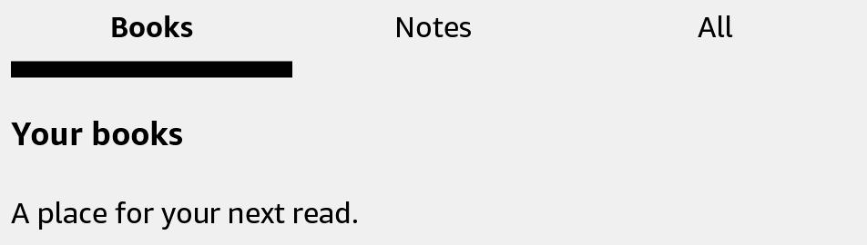

# Page

Define a named page inside Notebook.



## Usage

Save this example as `apps/Reader/App.js` in the [starter app](../first-app.md).

```jsx
import React, {useState} from 'react';
import {Notebook, Page, TabBar, Text, View} from 'react-kindle';

export default function App() {
  const [page, setPage] = useState('books');

  return (
    <View style={{flex: 1, padding: 24}}>
      <TabBar value={page} onValueChange={setPage} tabs={[
        {value: 'books', label: 'Books'}, {value: 'notes', label: 'Notes'},
      ]} />
      <Notebook page={page}>
        <Page name="books" style={{padding: 24}}><Text>Your books</Text></Page>
        <Page name="notes" style={{padding: 24}}><Text>Your notes</Text></Page>
      </Notebook>
    </View>
  );
}
```

## Props

| Prop | Type / default | Description |
|---|---|---|
| name | nonempty string | Unique name matched by Notebook.page. |
| children | React nodes | Page content. |
| style | View style | Styles the inner layout view. |

Hidden pages stay mounted. Stop timers or background work when their page is inactive. Notebook needs a parent with a defined height or flex space.
