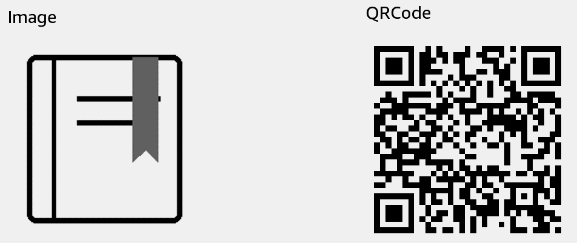

# QRCode

Encode text or a URL as a QR code.



## Usage

Save this example as `apps/Reader/App.js` in the [starter app](../first-app.md).

```jsx
import React from 'react';
import {QRCode, View} from 'react-kindle';

export default function App() {
  return (
    <View style={{padding: 24}}>
      <QRCode value="https://example.com/library" size={180} />
    </View>
  );
}
```

## Props

| Prop | Type / default | Description |
|---|---|---|
| value | string | Text to encode. |
| size | positive number = 132 | Requested size. |
| margin | nonnegative number = 4 | Code margin. |
| onResize | (size: number) => void | Native size result. |
| onError | (error: Error) => void | Reports a value too long to encode. |
| style | View style | Layout overrides. |
