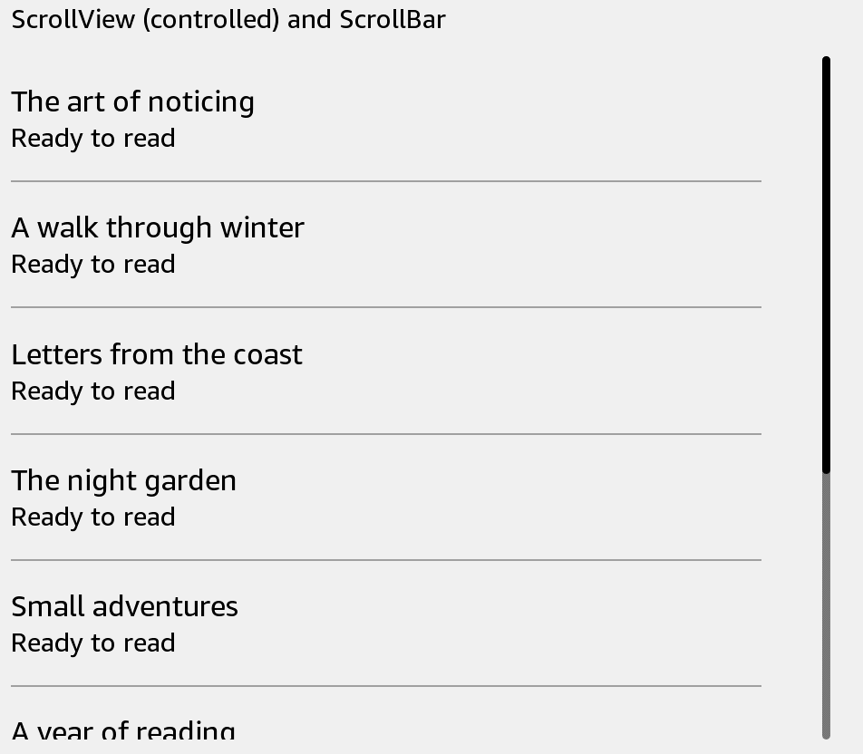

# ScrollBar

Let users move forward or backward through a collection. Your app updates the visible content.



## Usage

Save this example as `apps/Reader/App.js` in the [starter app](../first-app.md).

```jsx
import React, {useState} from 'react';
import {ScrollBar, Text, View} from 'react-kindle';

export default function App() {
  const [index, setIndex] = useState(0);

  return (
    <View style={{padding: 24, flexDirection: 'row', height: 420}}>
      <View style={{flex: 1}}>
        {Array.from({length: 5}, (_, row) => (
          <Text key={row} style={{height: 64}}>Book {index + row + 1}</Text>
        ))}
      </View>
      <ScrollBar index={index} count={20} pageSize={5} style={{width: 40, height: 360}}
        onForward={() => setIndex(value => Math.min(15, value + 5))}
        onBackward={() => setIndex(value => Math.max(0, value - 5))} />
    </View>
  );
}
```

## Props

| Prop | Type / default | Description |
|---|---|---|
| index | nonnegative integer | First visible item index. |
| count | nonnegative integer | Total number of items. |
| pageSize | positive integer | Number of visible items. |
| horizontal | boolean = false | Scrollbar direction. |
| onForward / onBackward | () => void | Movement callbacks. |
| style | View style | Set scrollbar dimensions. |

The screenshot shows ScrollBar at the far right of a scrolling list. It only reports direction; connect its callbacks to your own paging state or a controlled ScrollView.
