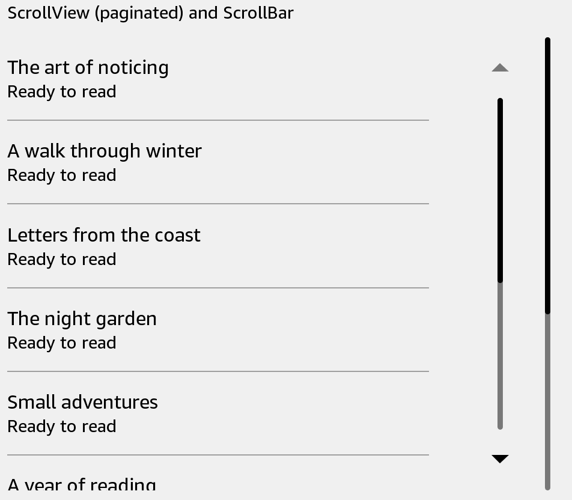

# ScrollView

Show content that is taller or wider than its viewport. Paginated mode provides native page movement.



## Usage

Save this example as `apps/Reader/App.js` in the [starter app](../first-app.md).

```jsx
import React from 'react';
import {ScrollView, Text, View} from 'react-kindle';

export default function App() {
  return (
    <View style={{flex: 1, padding: 24}}>
      <ScrollView mode="paginated" offset={0} style={{height: 480}}
        contentContainerStyle={{padding: 16}}>
        {Array.from({length: 20}, (_, index) => (
          <Text key={index} style={{height: 64}}>Book {index + 1}</Text>
        ))}
      </ScrollView>
    </View>
  );
}
```

## Props

| Prop | Type / default | Description |
|---|---|---|
| mode | paginated (default) / controlled | Native scrolling mode. |
| horizontal | boolean = false | Scroll direction. |
| style | View style | Viewport dimensions. |
| contentContainerStyle | View style | Inner content layout. |
| onForward / onBackward | () => void | Directional scroll or page-key callbacks. |
| onScroll | function | Native scroll event. |
| onKeyPress | function | Native key event. |
| onMomentumScrollBegin | function | Overrides the default directional handler. |
| ref | scrollTo(options) | Programmatic scrolling in controlled mode. |

## Controlled scrolling


Use `mode="controlled"` for a viewport controlled by your app. A ref exposes `scrollTo({x, y, animated})`. Check `useKindle().supports('controlledScroll.scrollTo')` before using the command; the KT3 standalone launcher does not export it.

`offset={0}` in the paginated example starts at the beginning. Other native scroll props pass through to the selected host. [ScrollBar](scroll-bar.md) is a separate control; it does not scroll this content automatically.


```jsx
import React, {useRef} from 'react';
import {Button, ScrollView, Text, View, useKindle} from 'react-kindle';

export default function App() {
  const scroll = useRef(null);
  const {supports} = useKindle();
  return (
    <View style={{flex: 1, padding: 24}}>
      <Button disabled={!supports('controlledScroll.scrollTo')}
        onPress={() => scroll.current.scrollTo({x: 0, y: 0, animated: false})}>
        Back to top
      </Button>
      <ScrollView ref={scroll} mode="controlled" style={{height: 480}}>
        {Array.from({length: 20}, (_, index) => (
          <Text key={index} style={{height: 64}}>Book {index + 1}</Text>
        ))}
      </ScrollView>
    </View>
  );
}
```
