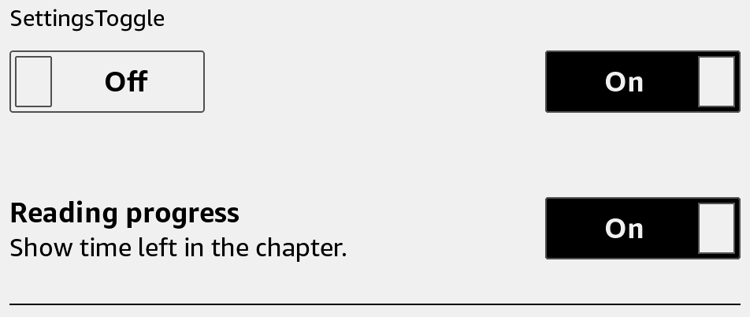

# SettingsRow

Place a setting title and description beside its control.



## Usage

Save this example as `apps/Reader/App.js` in the [starter app](../first-app.md).

```jsx
import React, {useState} from 'react';
import {SettingsRow, SettingsToggle, View} from 'react-kindle';

export default function App() {
  const [enabled, setEnabled] = useState(true);

  return (
    <View style={{padding: 24}}>
      <SettingsRow title="Show covers" description="Display covers in the library.">
        <SettingsToggle value={enabled} onValueChange={setEnabled} />
      </SettingsRow>
    </View>
  );
}
```

## Props

| Prop | Type / default | Description |
|---|---|---|
| title | string | Setting name. |
| description | string | Optional explanation below the title. |
| children | React node | Trailing control. |
| style | View style | Row layout. |
