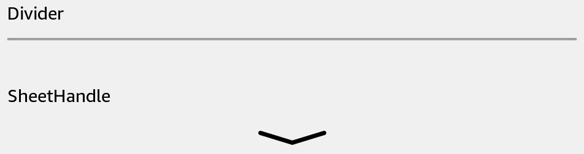

# SheetHandle

Give a sheet a native swipe handle. BottomSheet includes this control automatically.



## Usage

Save this example as `apps/Reader/App.js` in the [starter app](../first-app.md).

```jsx
import React, {useState} from 'react';
import {SheetHandle, Text, View} from 'react-kindle';

export default function App() {
  const [dismissed, setDismissed] = useState(false);

  return (
    <View style={{padding: 24}}>
      <SheetHandle direction="down" onSwipeDown={() => setDismissed(true)} />
      <Text>{dismissed ? 'Dismiss requested' : 'Swipe down on the handle'}</Text>
    </View>
  );
}
```

## Props

| Prop | Type / default | Description |
|---|---|---|
| direction | none (default) / up / down | Gesture hint. |
| onSwipeUp / onSwipeDown | function | Gesture callbacks. |
| accessibilityLabel | string | Defaults to the direction hint. |
| style | View style | Container layout; default height is 32. |
