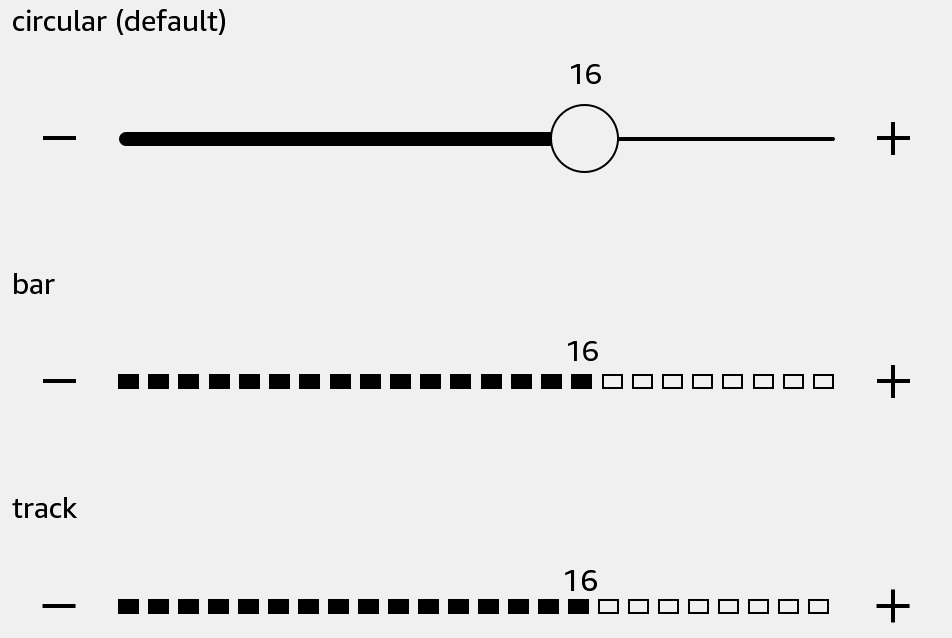

# Slider

Choose an integer within a range. The default circular thumb matches Kindle Quick Settings.



## Usage

Save this example as `apps/Reader/App.js` in the [starter app](../first-app.md).

```jsx
import React, {useState} from 'react';
import {Slider, Text, View} from 'react-kindle';

export default function App() {
  const [level, setLevel] = useState(16);

  return (
    <View style={{padding: 24}}>
      <Text>Level: {level}</Text>
      <Slider value={level} minimumValue={0} maximumValue={24} onValueChange={setLevel} />
      <Slider variant="bar" value={level} minimumValue={0} maximumValue={24} onValueChange={setLevel} />
      <Slider variant="track" value={level} minimumValue={0} maximumValue={24} onValueChange={setLevel} />
    </View>
  );
}
```

## Props

| Prop | Type / default | Description |
|---|---|---|
| value | integer = 3 | Current value, clamped to the range. |
| minimumValue / maximumValue | integer = 0 / 5 | Minimum must be less than maximum. |
| variant | circular (default) / bar / track | Round thumb, segmented bar, or native track control. |
| onValueChange | (value: number) => void | Receives a bounded integer. |
| continuous | boolean = false | Emit changes during movement. |
| disabled | boolean = false | Prevents editing. |
| style | View style | Default width is 100%; height is 85 for circular and 64 otherwise. |

Keep `value` in state. If your callback rejects a change, the slider restores the supplied value. This example changes an app value; it does not change the device brightness.
