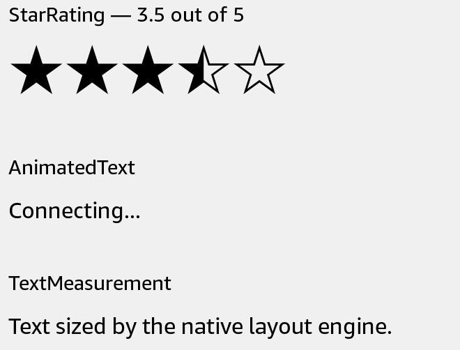

# StarRating

Display a read-only rating out of five stars.



## Usage

Save this example as `apps/Reader/App.js` in the [starter app](../first-app.md).

```jsx
import React from 'react';
import {StarRating, View} from 'react-kindle';

export default function App() {
  return (
    <View style={{padding: 24}}>
      <StarRating value={3.5} size={32} />
    </View>
  );
}
```

## Props

| Prop | Type / default | Description |
|---|---|---|
| value | finite number | Rating, clamped to 0–5. |
| size | positive number = 24 | Kindle Symbol glyph size. |
| style | Text style | Text layout and color. |

Fractions above .25 and below .75 show a half star; .75 and above round to the next full star. The control provides a spoken rating label.
