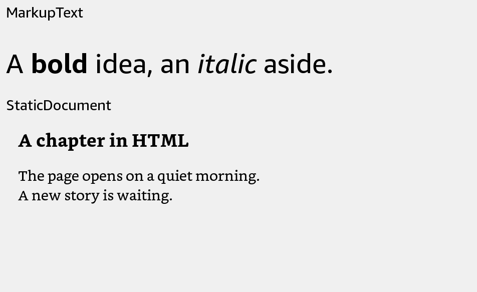

# StaticDocument

Display a local HTML document inside your app.



## Usage

Save this example as `apps/Reader/App.js` in the [starter app](../first-app.md).

```jsx
import React from 'react';
import {StaticDocument, View} from 'react-kindle';

export default function App() {
  return (
    <View style={{flex: 1, padding: 24}}>
      <StaticDocument source="/mnt/us/extensions/Reader/res/help.html"
        style={{width: '100%', height: 400}} />
    </View>
  );
}
```

## Props

| Prop | Type / default | Description |
|---|---|---|
| source | path, file URI, or source object | Required local HTML source. |
| style | View style | Set a width and height for the document viewport. |
| onLayout | function | Receives outer layout events. |

## HTML file

Save this as `apps/Reader/res/help.html` before building:

```html
<!doctype html>
<html><head><meta charset="utf-8"><title>Help</title></head>
<body><h1>Library</h1><p>Select a book to start reading.</p></body></html>
```

The viewport follows the component dimensions. Changing its size recreates the native document view. The 5.16 standalone launcher does not expose a usable source property; this component requires a launcher that supports `staticDocument`.
