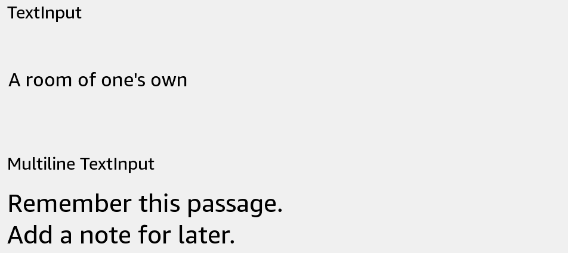

# TextInput

Edit plain text.



## Usage

Save this example as `apps/Reader/App.js` in the [starter app](../first-app.md).

```jsx
import React, {useState} from 'react';
import {TextInput, Text, View} from 'react-kindle';

export default function App() {
  const [name, setName] = useState('Reading');

  return (
    <View style={{padding: 24}}>
      <TextInput accessibilityLabel="Collection name"
        value={name} onChangeText={setName} style={{width: '100%', height: 64}} />
      <Text>{name || 'Untitled collection'}</Text>
    </View>
  );
}
```

## Props

| Prop | Type / default | Description |
|---|---|---|
| value | string | Controlled text. |
| defaultValue | string | Initial text when value is omitted. |
| onChangeText | (text: string) => void | Update your state after an edit. |
| multiline | boolean = false | Use the multiline editor. |
| editable | boolean = true | Allow editing. |
| style | View style | Component dimensions and layout. |
| ref | focus() / blur() | Native focus commands. |
| onChange | function | Receives the native change event. |
| autoFocus | boolean | Focus on mount; requires native focus support. |
| fontDescription | string | Native font description. |

## Variants

Set `multiline` for longer text. Give the editor enough height to show several lines. Both editor types default to a 445 × 111 frame; set dimensions for your layout.

## Focus and firmware

Check `useKindle().supports('textInput.focus')` before offering a single-line focus action. Multiline focus and blur commands are unavailable on the tested launchers. In standalone apps, `blur()` clears focus but leaves the system keyboard visible. On the KT3 launcher, multiline font overrides do not work.
