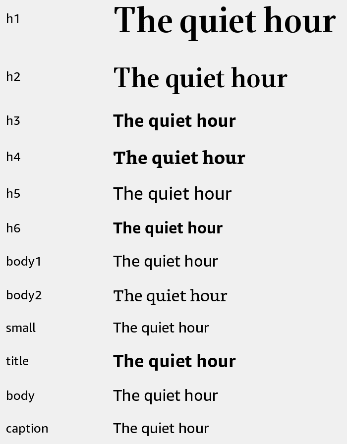

# Text

Display text using Kindle font and size presets.



## Usage

Save this example as `apps/Reader/App.js` in the [starter app](../first-app.md).

```jsx
import React from 'react';
import {Text, View} from 'react-kindle';

export default function App() {
  return (
    <View style={{padding: 24}}>
      <Text variant="h1">Library</Text>
      <Text>Continue where you left off.</Text>
      <Text variant="caption">12 books</Text>
    </View>
  );
}
```

## Props

| Prop | Type / default | Description |
|---|---|---|
| children | text / text nodes | Text content. |
| variant | string = body | Typography preset. |
| size | number | Override base font size before scaling. |
| style | Text style | Color, alignment, and other text styles. |

## Typography presets

| Variant | Font | Size / line height | Weight |
|---|---|---|---|
| h1 | Bookerly Display | 36 / 56 | Normal |
| h2 | Bookerly Display | 28 / 40 | Normal |
| h3 | Amazon Ember | 20 / 24 | Bold |
| h4 | Bookerly | 20 / 24 | Bold |
| h5 | Amazon Ember | 20 / 24 | Medium |
| h6 | Amazon Ember | 18 / 24 | Bold |
| body1 | Amazon Ember | 18 / 24 | Normal |
| body2 | Bookerly | 18 / 24 | Normal |
| small | Amazon Ember | 16 / 20 | Normal |
| title | Amazon Ember | 20 / 32 | Bold |
| body | Amazon Ember | 18 / 26 | Normal |
| caption | Amazon Ember | 16 / 24 | Normal |

Font sizes follow the current font scale. The `title`, `body`, and `caption` presets also scale line height. Other presets keep the listed line height. Standard React Native text props are passed through.
